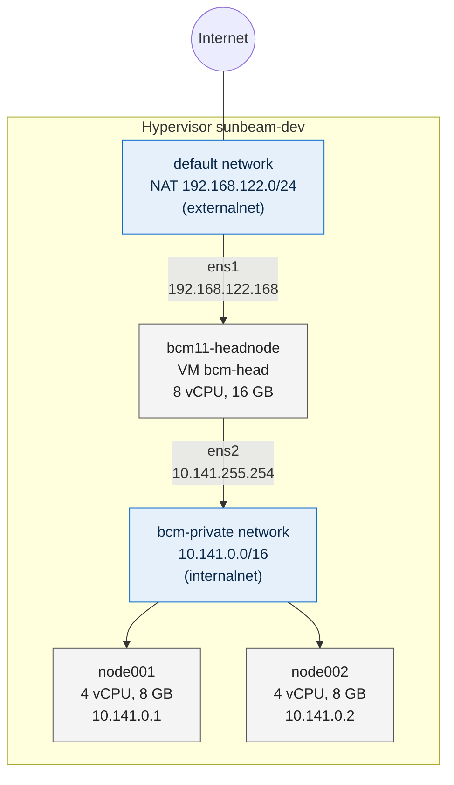

# List existing nodes
```
root@bcm11-headnode:~# cmsh -c "device list"
Type             Hostname (key)   MAC                Category         IP               Network          Status
---------------- ---------------- ------------------ ---------------- ---------------- ---------------- --------------------------------
HeadNode         bcm11-headnode   52:54:00:4B:F5:22                   10.141.255.254   internalnet      [   UP   ], health check failed
PhysicalNode     node001          52:54:00:68:B8:7A  default          10.141.0.1       internalnet      [   UP   ], health check failed
PhysicalNode     node002          52:54:00:8F:4E:AC  default          10.141.0.2       internalnet      [   UP   ], health check failed
```

# List node category
```
root@bcm11-headnode:~# cmsh -c "category list"
Name (key)               Software image           Nodes
------------------------ ------------------------ --------
default                  default-image            2
```

# List images
```
root@bcm11-headnode:~# cmsh -c "softwareimage list"
Name (key)           Path (key)                               Kernel version    Nodes
-------------------- ---------------------------------------- ----------------- --------
default-image        /cm/images/default-image                 7.0.0-27-generic  2
```
# List network
```
root@bcm11-headnode:~# cmsh -c "network list"
Name (key)         Type           Netmask bits   Base address     Domain name          IPv6   Layer3
------------------ -------------- -------------- ---------------- -------------------- ------ ------
externalnet        External       24             192.168.122.0    nvidia.com           no     no
globalnet          Global         0              0.0.0.0          cm.cluster           no     no
internalnet        Internal       16             10.141.0.0       eth.cluster          no     no
```
# Hosts
| Machine | vCPU / RAM | Network | IP | Category | Image | Slurm |
|---|---|---|---|---|---|---|
| `bcm11-headnode` (VM `bcm-head`) | 8 / 16 Go | externalnet, internalnet | 192.168.122.168, 10.141.255.254 | none | n/a | partition `defq`, node `idle` |
| `node001` | 4 / 8 Go | internalnet | 10.141.0.1 | `default` | `default-image` | **missing from `sinfo`** |
| `node002` | 4 / 8 Go | internalnet | 10.141.0.2 | `default` | `default-image` (kernel 7.0.0-27-generic) | **missing from `sinfo`** |

Network mapping: libvirt `default` = BCM `externalnet` ; libvirt `bcm-private` = BCM `internalnet`. `globalnet` network (0.0.0.0/0) is a logicial object shared with BCM, it's not bound to libvirt.
# Network diagram

